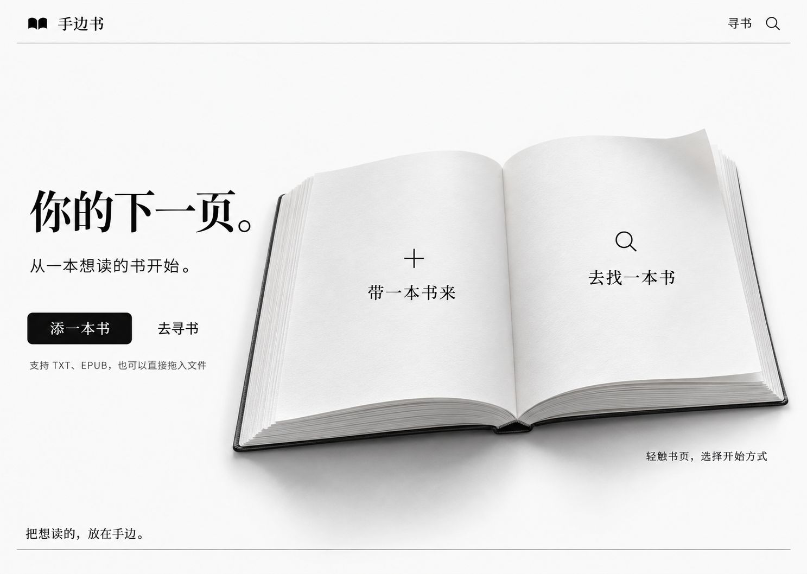
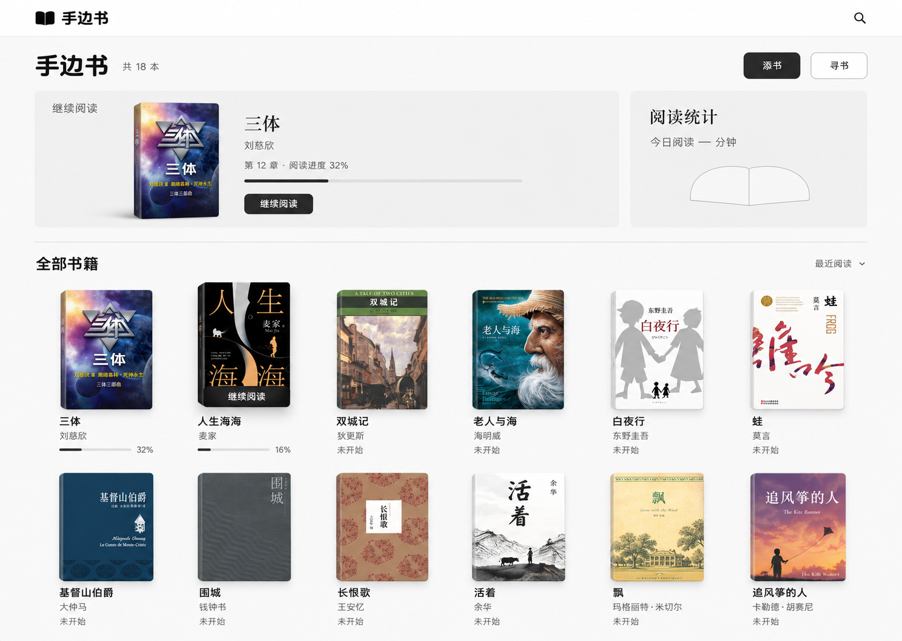
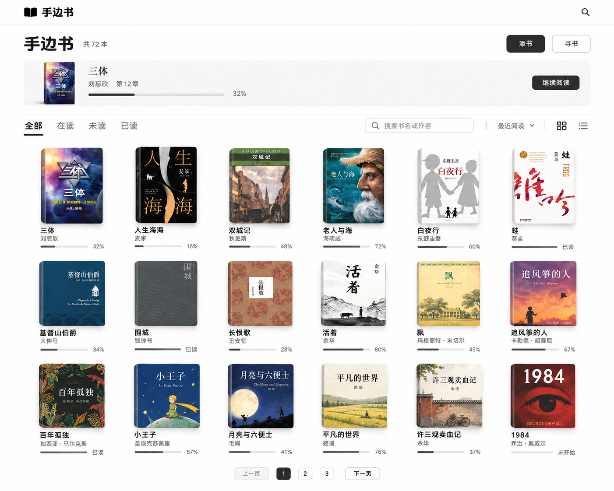

# 手边书：产品、UI 与开发交接

更新日期：2026-11-25（Asia/Shanghai）

## 交接状态

本文记录 Leo 与 Codex 已讨论的产品方向，供换设备后继续开发。本次仅保存文档与概念图，没有实施本文新增功能。

- 当前 AI 等级为 **L2 解释模式**。继续对话时先阅读本文；修改业务代码前须由 Leo 明确授权 L3 与文件范围。
- 本文的“已确认”表示产品决定；概念图是静态视觉提案，不代表已有可运行页面或完成验收。
- 仅本文标记的空状态视觉方向得到认可。书签寻书已确认流程，尚无对应的完整交互稿或动效实现。
- 两个仓库原有未提交代码、图片、上传文件均未纳入本次文档提交，换设备后不会自动出现。
- 源码仓库不等于服务器数据备份。账号、数据库、正文文件和运行时配置需要另行迁移或连接已有开发服务器。

## 仓库与继续工作

| 项目 | 仓库 | 本次交接分支 | 创建时基线 |
|---|---|---|---|
| Vue 前端 | https://github.com/ChuFan0915/aireading-Web | codex/bookshelf-product-handoff | main，7a547c2 |
| Koa 后端 | https://github.com/ChuFan0915/aireading-hub-server | codex/bookshelf-product-handoff | render-deploy，504ceea |

换设备后，在两个仓库分别执行（有本地改动时先自行保存，不覆盖）：

```sh
git fetch origin
git switch --track origin/codex/bookshelf-product-handoff
```

如果本地已经存在同名分支，使用 `git switch codex/bookshelf-product-handoff`，再检查远程差异。尚未合并到 main；后端交接分支基于 render-deploy，不应直接假定与 main 相同。

建议将两个仓库放在同一父目录，分别命名为 `novelReader` 与 `novelReader-server`。当前后端托管前端 dist 的路径依赖这个目录关系。

## 已确认的产品定位

个人小说阅读器：高级感、有创意的交互、简洁美。朋友首次访问时没有任何书，页面本身需要有吸引力，也要提供明确的第一步。

核心闭环：访问空书架 → 添加本地书或输入书籍口令 → 注册/登录 → 保存到账号书架 → 开始阅读 → 换设备恢复。

### 账号

- 注册只需账号、密码，不使用手机、邮箱或验证码。
- 注册成功自动登录，不再要求手动登录一次。
- 原有账号使用账号、密码登录。
- 书架与阅读进度保存于服务器，按账号区分。
- 未登录可先输入口令并揭晓书籍；确认收进书架时登录/注册，完成后继续刚才的领取，不要求重输口令。
- UI 简单不代表后端省略密码哈希、输入校验、账号唯一性、会话验证与访问授权。

### 书籍口令

- 最终确定 **书签寻书**。不是在线小说关键词搜索，也不是“书信领书”或“心情选书”。
- Leo 先在服务器准备书籍，为书籍发放可分享口令。
- 当前按一个口令对应一本书设计；同一口令可由多个账号领取。
- 同一账号重复领取同一本书不重复创建书架记录、不清空阅读进度。
- 采用服务器查询口令与书籍的映射即可，不要求把文件或书籍信息加密进口令。
- 书籍已在服务器时，领取只建立书架关联，不重复下载、解析或复制文件，也不自动下载到用户设备。
- 口令管理后台、分享链接自动携带口令、批量领书均未纳入已确认的首版范围。
- 如果以后要支持外部来源下载，需另定可信来源、授权、重试与导入规则；不由用户口令提供任意抓取地址。

## 视觉方向

### 已认可的空书架方向



- 概念名“你的下一页”：展开的书作为页面主角，左侧简洁文案与明确按钮。
- 保留黑白灰、纸张质感、细微光影和留白；左页添本地书，右页口令寻书。
- 不采用上一轮的灰色大上传卡片、单本直立白书方案；该方案已被 Leo 否定，不应回退实现。
- 图中右页的放大镜与“去找一本书”是旧概念表达，实施时应按最终口令流程调整，并先产出相应交互设计。
- 图中的重复按钮、提示语和底部文案尚需在实现前收敛；不要把概念图的全部文案视为最终冻结稿。
- 账号无书时不展示空统计、假进度、假书籍或无效的“继续阅读”。

### 书架有书时的方向参考





这两张是此前讨论的方向参考，不是最终验收稿。图中数量、章节、百分比、书封均为设计示例，不是账号真实数据或可直接上线的生产素材。

- 有阅读记录才展示“继续阅读”，恢复最近读到的章节。
- 书籍少时保持正常封面尺寸，左对齐，不为填满屏幕而拉大。
- 书籍多时让书架占主要空间，继续阅读可收成横条。
- 大量书籍可增加书名/作者搜索、排序、分页；列数随可用宽度变化，不因书多无限缩小封面。
- 桌面约 5–6 列，手机约 2–3 列是讨论参考，实际需按可读性验证。
- 在读/未读/已读筛选是后续建议，不是现有 progress 字段已完整支持的功能；需先定义完成规则。
- 阅读统计与列表视图不是首版必要项，不用假数据填补。
- 搜索无结果与账号无书须区分，前者保留清除筛选入口。

## 书签寻书：已确认交互

| 步骤 | 用户动作与页面行为 |
|---|---|
| 进入 | 点击右页“寻书”，一枚细长书签从上沿滑出，页内出现“输入书籍口令”的输入框与按钮 |
| 校验 | 粘贴口令并点击“寻书”，服务器校验；书签缓缓插入两页之间 |
| 揭晓 | 校验成功后，右页翻开，露出封面、书名、作者与“收进书架” |
| 登录 | 尚未登录时，在确认领取后注册/登录，并保留当前口令和书籍上下文 |
| 领取 | 服务器确认书架保存成功，书封缩小归位；第一本书使空页面过渡为有书书架 |
| 阅读 | 归位后提供“开始阅读”，重复领取已有书时也提供这个入口 |

### 动效与可访问性

- 书签只随操作运动，不持续漂浮。
- 可以将拖动书签作为增强交互，点击按钮始终可用；拖动不是必做动作。
- 手机以点击为主，不依赖悬停。
- 动画短暂、可跳过，尊重减少动态效果偏好；可降级为淡入切换。
- 服务器状态驱动显示：校验完成前不虚假揭晓；领取保存完成前不虚假归位。
- 加载中防止重复提交；取消、失败、关闭后允许再次操作。
- 书本、书签素材与 UI 分离，真实文字、输入框和按钮用原生组件，不把整张概念图当 UI。

### 异常与边界

| 状态 | 预期结果 |
|---|---|
| 空口令 | 原位提示输入，不发起无意义请求 |
| 无效/停用口令 | 书签轻退，说明原因，保留输入内容 |
| 口令对应书籍缺失 | 可理解的失败提示，不创建书架记录 |
| 已在书架 | 不重复加书，不重置进度，提供开始阅读 |
| 网络失败 | 保留输入/已揭晓内容，允许重试 |
| 登录过期 | 登录后继续领取，不丢失上下文 |
| 快速连点/并发领取 | 每个账号每本书仍只有一条书架记录 |

## 数据归属与后端约束

- `Book` / `Chapter` / 封面 / 正文文件：服务器保存，可供多个已领取用户共享底层数据。
- `Bookshelf`：账号与书籍的关联，记录各自阅读位置，保留 `(userId, bookId)` 唯一约束。
- 新增口令实体的字段/名称尚未定稿；至少需要能识别口令、关联书籍、判断是否可用。
- 用户应只能获取自己已加入书架的正文；仅验证 JWT、不验证书籍访问权不够。
- 未登录的口令预览只提供必要元数据，不泄露整书正文。
- 从个人书架移除不删除公共书籍、其他用户的书架或正文文件。
- 用户 ID 从认证上下文获取，不信任客户端传入的任意用户 ID。
- 口令生成应足够难猜，口令查询需考虑防枚举；不在日志记录密码、完整 Token 或有效口令。
- 口令停用与并发领取的语义需在实现前明确，并让数据库更新与可用性检查保持一致。

## 当前源码阅读发现（未在本次重新运行验证）

初轮只读梳理基于未提交工作区，换设备时源码可能与这些观察不同，必须重新核对。

- 前端 Vue 3 / TypeScript / Vite / Naive UI / Tailwind；后端 Koa / TypeScript / Prisma。
- 前端主要入口为 `src/views/BookShelf/index.vue`、阅读页 `src/views/BookShelf/Components/BookRead.vue`、`src/utils/serves.ts` 与 `src/utils/request.ts`。
- 后端按 routes → controllers → services 组织，已有账号密码注册/登录路由和邮箱流程；前端此前仍接邮箱注册。
- 导入支持 TXT / EPUB；正文主要存 `storage/chapters`，元数据存数据库；封面在 `uploads/covers`。
- 阅读页当时通过 `/api/books/:bookId/read` 一次取整书；progress 存的是章节序号而非百分比。
- 当前数据库 Schema 声明 SQLite 却包含 MySQL 原生类型，配置文件也出现 MySQL 地址；先确认真实数据库及生成客户端，勿直接运行迁移或 db push。
- 前端 API 地址此前硬编码 localhost；换机器/部署前需要确认 API、资源地址与运行配置。
- 原有 crawlers 不是本次口令领书功能；不因为右页仍叫“寻书”而继续接关键词爬虫。
- 当前没有完成本轮构建、接口、动效或跨账号测试，不声称功能已实现。

## 建议的分阶段任务（待 Leo 授权 L3）

1. **复核基线**：读项目约定、Git 状态、数据库配置与现有认证；明确允许修改的文件、任务等级及验收标准。
2. **完成交互稿**：基于已认可空书架图补齐输入、校验、揭晓、登录、成功与失败；确定桌面/手机与减少动态版本。
3. **简化账号**：账号密码注册与自动登录；登录继续未完成的领书；退出清除会话。
4. **实现口令领书**：设计口令映射、受控发放方式、预览与领取接口、重复请求处理、书籍访问权与账号隔离。
5. **接入服务器书架**：真实书架渲染、阅读恢复、本地上传继续可用；保持共享正文与个人记录分离。
6. **实现视觉与动效**：分离书本素材、原生控件与状态；用实际浏览器截图对照概念与最终交互稿检查。
7. **验收**：账号注册自动登录；无文件访客口令领书；同口令多账号；重复/并发领取；跨账号拒绝正文访问；失败重试；跨设备进度；移动端与键盘。

适合 Leo 独立解释的知识点：共享书籍与个人书架的区别、服务端授权、幂等与唯一约束、前端异步状态、章节位置与阅读完成状态的区别。

独立练习：画出两个账号同时领取一个口令、各自阅读到不同章节的时序图，标明哪些数据共享、哪些数据必须隔离。

## 在新设备继续的提示词

> 请先阅读 docs/PRODUCT_UI_HANDOFF.md 和当前仓库约定，检查两个仓库的 Git 状态。我们已确定“你的下一页”空书架视觉、书签口令寻书、账号密码注册自动登录和服务器个人书架。当前为 L2，请先核对现有源码与交接文档的差异、列出首个训练任务和验收标准，不直接代写核心业务代码。修改代码前由我确认 L3 与具体范围。不要将静态设计提案或本次文档提交描述成已实现功能。
